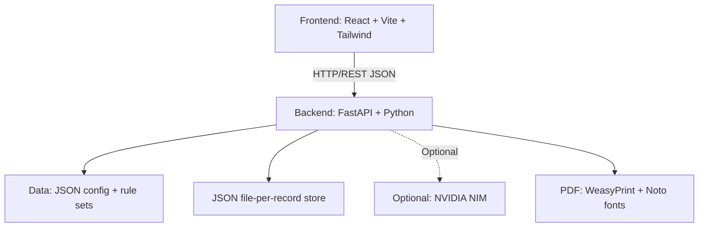

# FarmerX — Technical Report

**Project:** FarmerX — Soil-to-Action Execution Layer  
**Repository:** https://github.com/avan-codes/FarmerX.git  
**Branch:** `main`  
**Commit Convention:** Conventional Commits  
**Prepared for:** Technical documentation

---

## 1. Abstract

FarmerX is an agronomic decision-support platform for Indian smallholder farmers. It provides a deterministic, config-driven fertilizer recommendation API (backend) and a React + Vite frontend (dashboard, farm registration, market prices, news, AI assistant, and reports). The system is built in three phases — deterministic core, optional NIM AI explainer, and production features (PDF export, market prices, news, farms/profile). AI is optional; the core recommendation engine works fully offline without any LLM.

---

## 2. Problem Statement

Indian farmers often lack access to localized, crop-specific fertilizer recommendations that account for soil health, region, crop, and growth stage. Existing solutions are either too generic, not available in regional languages, or depend on proprietary/AI-heavy stacks that fail in low-connectivity areas. FarmerX addresses this by:

- Providing **deterministic recommendations** from committed config and rule sets (no hardcoded doses).
- Offering **optional AI explanations** that degrade gracefully when unavailable.
- Supporting **7 Indian languages** for PDF export.
- Never **fabricating market prices or news** — explicit stale/empty states instead of hallucinated data.

---

## 3. System Architecture

### 3.1 High-Level Diagram



### 3.2 Backend Layered Architecture

| Layer | Responsibility |
|-------|----------------|
| **Routers** (`app/api/v1/routers/`) | HTTP route handling, request/response validation |
| **Services** (`app/services/`) | Business logic: AI, PDF, market prices, news |
| **Domain** (`app/domain/`) | Rule engine, guardrails, thresholds, units, snapshots |
| **Providers** (`app/providers/`) | LLM (nim/none), market (data.gov.in), news (RSS) |
| **Repositories** (`app/repositories/`) | Config loading, JSON store, rule sets, audit log |
| **Core** (`app/core/`) | Settings, errors, logging, pagination, security |

### 3.3 Frontend Architecture

| Module | Responsibility |
|--------|----------------|
| `src/pages/` | Route-level page components |
| `src/features/` | Domain feature modules (dashboard, farms, market, news, reports, assistant) |
| `src/components/` | Reusable UI + layout components |
| `src/hooks/` | Custom React hooks for data fetching |
| `src/services/` | Axios-based API service layer |
| `src/lib/` | Config reader, datetime, uuid utilities |

---

## 4. Tech Stack

| Layer | Technology | Version / Notes |
|-------|-----------|-----------------|
| Backend Language | Python | 3.11+ |
| Backend Framework | FastAPI | ASGI, auto OpenAPI/Swagger |
| PDF Engine | WeasyPrint | HTML → PDF |
| Font Verification | fontTools | Glyph coverage before render |
| Frontend | React 18 + Vite | SPA, ES modules |
| Styling | Tailwind CSS | v4.x (PostCSS) |
| Routing | React Router DOM | v6 |
| Charts | Recharts | Price trend visualization |
| Icons | Lucide React | |
| HTTP Client | Axios | |
| Backend Testing | pytest | 84 passed, 4 skipped |
| Frontend Linting | ESLint | v9 flat config |
| Config Format | JSON | Committed under `backend/data/config/` |
| Storage | JSON file-per-record | File locking, single writer |

---

## 5. Development Phases

| Phase | Name | Ships | AI Dependency |
|-------|------|-------|---------------|
| **1** | Deterministic core | Config repo, JsonStore, rule engine, `POST /recommendations`, audit log | **None** |
| **2** | NIM explainer | Summarize, answer, guardrails, cache, budget, degradation | Optional (`LLM_PROVIDER=none` works) |
| **3** | Production | PDF (7 languages), market prices, news, farms/profile, admin audit, health, Docker | Optional; PDF uses cached summary only |

---

## 6. Backend API Endpoints

### Recommendations (Phase 1–2)

| Method | Path | Auth | Description |
|--------|------|------|-------------|
| `POST` | `/api/v1/recommendations` | `X-Farmer-Id` | Create soil-based fertilizer recommendation |
| `GET` | `/api/v1/recommendations/{rec_id}` | `X-Farmer-Id` | Get recommendation (+ cached AI summary) |
| `POST` | `/api/v1/recommendations/{rec_id}/summary` | `X-Farmer-Id` | Generate AI summary (guardrailed, cached) |
| `GET` | `/api/v1/recommendations/{rec_id}/assistant` | `X-Farmer-Id` | Get assistant conversation history |
| `POST` | `/api/v1/recommendations/{rec_id}/assistant` | `X-Farmer-Id` | Ask question scoped to report |
| `GET` | `/api/v1/recommendations/{rec_id}/pdf?language=xx` | `X-Farmer-Id` | Export to PDF (7 languages) |

### Market Prices (Phase 3)

| Method | Path | Auth | Description |
|--------|------|------|-------------|
| `GET` | `/api/v1/market-prices` | `X-Farmer-Id` | Query mandi prices |
| `GET` | `/api/v1/market-prices/commodities` | `X-Farmer-Id` | List commodities |
| `GET` | `/api/v1/market-prices/trend` | `X-Farmer-Id` | Price trend |

### News (Phase 3)

| Method | Path | Auth | Description |
|--------|------|------|-------------|
| `GET` | `/api/v1/news` | `X-Farmer-Id` | List news articles |
| `GET` | `/api/v1/news/{news_id}` | `X-Farmer-Id` | Get single news item |

### Profile & Farms (Phase 3)

| Method | Path | Auth | Description |
|--------|------|------|-------------|
| `GET/PUT` | `/api/v1/profile` | `X-Farmer-Id` | Farmer profile upsert |
| `GET/POST` | `/api/v1/farms` | `X-Farmer-Id` | List/create farm |
| `GET/PUT/DELETE` | `/api/v1/farms/{farm_id}` | `X-Farmer-Id` | Farm CRUD |

### Admin

| Method | Path | Auth | Description |
|--------|------|------|-------------|
| `GET` | `/api/v1/admin/rule-sets` | `X-Admin-Key` | List rule sets |
| `POST` | `/api/v1/admin/rule-sets/reload` | `X-Admin-Key` | Reload rule sets |
| `GET` | `/api/v1/admin/audit/recommendations` | `X-Admin-Key` | Audit log |
| `GET` | `/api/v1/admin/audit/ai` | `X-Admin-Key` | AI guardrail violations |

### Health & Config

| Method | Path | Description |
|--------|------|-------------|
| `GET` | `/api/v1/health` | Subsystem status |
| `GET` | `/api/v1/config/{crops\|regions\|stages\|units\|languages\|fertilizers\|soil-parameters}` | Reference data |
| `GET` | `/api/v1/docs` | Swagger/OpenAPI UI |

---

## 7. Frontend Features & Pages

### Pages
- `LandingPage`
- `DashboardPage` — metrics, recent reports, saved farms, market/news summary
- `FarmsPage` — farm registration + list
- `MarketPricesPage` — price table, filters, trend chart
- `NewsPage` / `NewsDetailPage` — article listing + detail
- `NewReportPage` — multi-step wizard (soil → context → review)
- `ReportDetailPage` — recommendation view + PDF export
- `ReportsPage` — history table
- `AssistantPage` — AI assistant chat
- `ProfilePage`
- `NotFoundPage`

### Feature Modules
- **Dashboard** — metrics row, saved farms, recent reports
- **Farms** — farm form, saved farm card
- **Market** — price filters, price table, trend chart
- **News** — news cards, category tabs
- **Reports** — AI summary panel, context/review/soil steps, workflow stepper
- **AI Assistant** — chat panel, floating button, overlay

### Key Frontend File
`Frontend/src/lib/config.js` — central env reader:
```js
apiBaseUrl: import.meta.env.VITE_API_BASE_URL || ''
```

---

## 8. Data Layer & Configuration

### Committed Config (`backend/data/config/`)

| File | Purpose |
|------|---------|
| `crops.json` | Crop registry |
| `regions.json` | Region registry |
| `stages.json` | Growth stages |
| `fertilizers.json` | Fertilizer registry |
| `soil_thresholds.json` | Per-region soil parameter thresholds |
| `rule_engine.json` | Rounding step, dose cap, caution keys |
| `translations/en.json`, `hi.json` | UI strings |
| `languages.json` | Supported languages |
| `units.json` | Area/quantity units + conversions |
| `ai.json` | Language names, summary settings |
| `news_categories.json` | Keyword → category mapping |

### Rule Sets (`backend/data/rule_sets/`)
Multi-region agronomic rules for **rice** and **wheat** across **basal / vegetative / flowering** stages in regions **BR, MH, MP, PB**.

### Storage Design
- JSON file-per-record store with file locking.
- Immutable snapshots per recommendation; PDF renders strictly from snapshot (never recomputes rule engine).
- Swap-able `StorageBackend` interface for future horizontal scaling.

---

## 9. AI / LLM Integration (Optional)

- **Default:** `LLM_PROVIDER=none` → AI disabled; recommendations work 100% deterministically.
- **Optional:** `LLM_PROVIDER=nim` → NVIDIA NIM provider (`meta/llama-3.1-8b-instruct`).
- **Guardrails** validate every LLM output before reaching the farmer:
  - Blocks ungrounded quantities
  - Blocks unknown fertilizers
  - Blocks unsupported units (e.g., litres)
  - Violations → `guardrail_blocked` + safe deterministic fallback
- **Resilience:** provider failure, budget exhaustion, and guardrail blocks degrade gracefully.

---

## 10. PDF Export

- Renders from **stored immutable snapshot** only.
- Glyph coverage verified with `fontTools` before rendering.
- 7 languages: en, hi, bn, mr, pa, ta, te (script-specific Noto fonts).
- Cached by `rec_id + language + template_version`.
- Template: `backend/app/templates/recommendation.html`.

---

## 11. Market Prices & News

**Empty-feed semantics (never fabricates):**
- `items: []`, `reason: "*_UNAVAILABLE"`, `stale: true`
- Feed failure → serves last stored snapshot with `stale: true`
- Dedupe by payload hash (market) / URL hash (news)

---

## 12. Security & Auth

| Mechanism | Detail |
|-----------|--------|
| Farmer auth | `X-Farmer-Id` header (MVP) |
| Admin auth | `X-Admin-Key` header |
| No JWT in MVP | Planned for later |
| No hardcoded doses | All agronomic values from config/rule sets |
| No PyMongo/MongoDB | Pure JSON file store |

---

## 13. Testing

```bash
pytest -q
```
**Expected: 84 passed, 4 skipped** (skips are font-coverage tests needing real Noto fonts).

| Test File | Phase |
|-----------|-------|
| `test_rule_engine.py` | 1 |
| `test_ai_service.py`, `test_api_assistant.py`, `test_guardrails.py` | 2 |
| `test_pdf.py`, `test_market_prices.py`, `test_news.py`, `test_farms_profile.py` | 3 |

---

## 14. Environment Variables

### Backend

| Variable | Default | Description |
|----------|---------|-------------|
| `LLM_PROVIDER` | `none` | `none` \| `nim` |
| `NVIDIA_API_KEY` | `` | NIM API key |
| `NIM_MODEL` | `meta/llama-3.1-8b-instruct` | NIM model |
| `AI_DAILY_REQUEST_BUDGET` | `500` | Daily AI budget |
| `PDF_FONT_DIR` | `data/fonts` | Noto TTF directory |
| `MARKET_INGEST_ENABLED` | `true` | Enable market ingestion |
| `NEWS_INGEST_ENABLED` | `true` | Enable news ingestion |

### Frontend (`Frontend/.env.example`)

| Variable | Default | Description |
|----------|---------|-------------|
| `VITE_API_BASE_URL` | `http://localhost:8000/api/v1` | Backend base URL |
| `VITE_APP_ENV` | `development` | Toggles mock mode |

---

## 15. Key Design Decisions

1. **AI is optional** — `LLM_PROVIDER=none` still gives 100% functional recommendations.
2. **Config-driven agronomy** — no hardcoded crops, regions, stages, thresholds, fertilizers, or doses.
3. **No fabricated market/news data** — empty feeds return explicit `stale: true` and `reason`.
4. **PDF from snapshots only** — rule engine never runs during PDF generation.
5. **Guardrails on all LLM output** — prevents hallucinated quantities/units reaching farmers.
6. **Single-writer JSON store** — simple, file-locked, swap-able for horizontal scaling later.

---

## 16. Git Commit History

| Commit | Scope | Message |
|--------|-------|---------|
| `eb66736` | `docs(root)` | Add project README with frontend + backend overview |
| `9fbaf9f` | `feat(backend)` | Update test suite and fixtures for new rule sets |
| `9da4d15` | `feat(backend)` | Add multi-region crop rule sets and config updates |
| `4089670` | `feat(frontend)` | Add FarmerX React frontend application |
| `fc3f531` | `docs(backend)` | Add README with architecture, API reference, and smoke test |
| `a6ebfdb` | `feat(backend)` | Add test suite and fixtures (Phase 1-3) |
| `3d0239a` | `feat(backend)` | Add Phase 1-3 FastAPI application |
| `a6d50b9` | — | first commit |

Format: `<type>(<scope>): <description>`  
Types: `feat`, `fix`, `docs`, `refactor`, `test`, `chore`  
Scopes: `backend`, `frontend`, `root`

---

## 17. Quick Start

### Backend
```bash
cd backend
pip install -e ".[dev]"
uvicorn app.main:app --reload
pytest -q
```

### Frontend
```bash
cd Frontend
cp .env.example .env
npm install
npm run dev
npm run build
```

### Together
Start the backend first, then the frontend. The frontend calls `VITE_API_BASE_URL` (default `http://localhost:8000/api/v1`).

---

## 18. License

Internal project — FarmerX.
